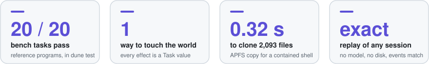
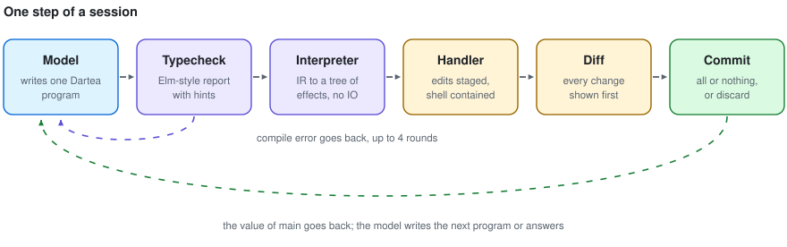
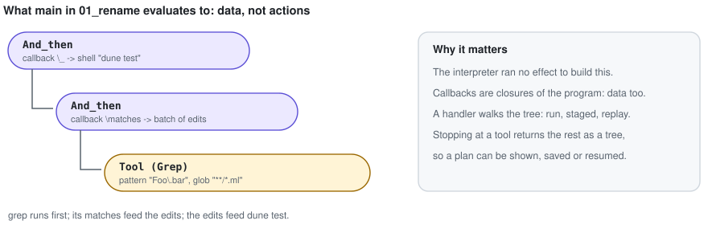
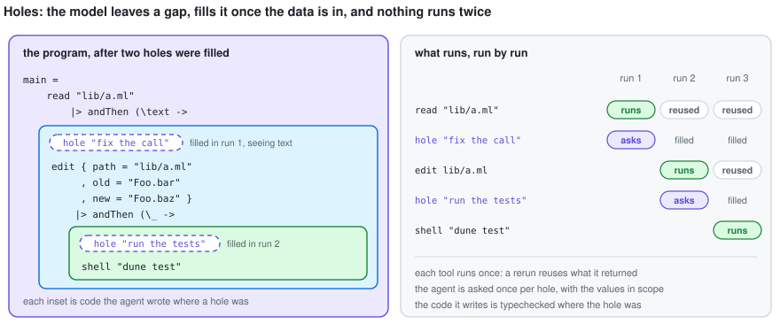

<div align="center">


# teagent

**A coding agent that writes one typed program, checked before anything runs.**

The model writes Dartea, a pure dialect of Elm. teagent typechecks it, checks what it could
leak, turns it into a tree of effects, runs every command in a sealed copy of your project, and
tracks where every value came from. Nothing leaves the folder without a reason you can read, and
any session can be undone with one command.


[Why](#why-teagent) · [Parts](#how-the-parts-fit) · [Security](#security-model) ·
[How it works](#how-it-works) · [Language](#the-language) · [Rules](#rules) ·
[Status](#status) · [Documents](#documents) · [Install](#install) · [Quick start](#quick-start)

</div>

<br>



<br>

```console
$ teagent -C ~/code/app --ask "Rename Foo.bar to Foo.baz in all .ml files, then run the tests"
```

```diff
--- a/lib/a.ml
+++ b/lib/a.ml
@@ -1,1 +1,1 @@
-let x = Foo.bar 1
+let x = Foo.baz 1
```

```console
$ teagent --undo ~/.teagent/sessions/0001.jsonl
Put back 2 file(s) in /Users/me/code/app:
  restored lib/a.ml
  restored lib/b.ml
```

## Why teagent

<table>
<tr>
<td width="50%" valign="top">

**A program, not tool calls.** The model answers with one Dartea program for the whole step.
A wrong argument is a type error before anything runs, and text read during a run cannot add a
call the program did not already have.

</td>
<td width="50%" valign="top">

**One way to act.** Dartea has no side effects, no FFI and no `eval`. The only way to touch the
world is a `Task` value, and only the harness decides what a task does.

</td>
</tr>
<tr>
<td valign="top">

**Data that knows its source.** Every value carries where its content came from: a file, a
search, a command's output. A request that would carry your project out stops and names the
files, before a byte leaves.

</td>
<td valign="top">

**Nothing irreversible by surprise.** Edits are staged in memory and written as one commit.
Files that other programs run, such as git hooks, CI and `AGENTS.md`, are held apart for a
person. Any session can be undone.

</td>
</tr>
<tr>
<td valign="top">

**A sealed shell.** Commands run in an APFS clone under a deny-by-default Seatbelt profile: no
network but a proxy to hosts you grant, no API keys in the environment, no clipboard, keychain
or sockets, and hard limits on time, files and processes.

</td>
<td valign="top">

**Exact replay, your own rules.** Every session is a log of what the world answered, replayed
with no model and no disk. Rules you write in Dartea can deny or question any call, with the
whole history of the session in view.

</td>
</tr>
</table>

## How the parts fit


| Part | Code | What it decides |
| --- | --- | --- |
| Person | you | the task; yes or no; `rules.elm`, the profile, `--net`, `--ask` |
| Model | `lib/llm` | nothing on its own: it only writes programs |
| Session loop | `lib/driver` | when to ask the model, compile, run and settle; writes the log |
| MCP server | `lib/mcp` | the same for another agent, with no person to ask |
| OS value | `lib/os` | what exists: calls, paths, hosts, limits, boot layers, rules; the image hash |
| Compiler | `lib/lang` | whether a program is well formed, and which calls it can reach |
| Interpreter | `lib/interp` | what `main` describes, and where each value came from |
| Run | `lib/run` | one program on its way to a value, through its holes |
| Handler | `lib/effect` | whether each call happens: budget, journal, policy; the staged overlay |
| Tools | `lib/tools`, `lib/device` | how a call happens: the only code that reads, writes, runs or connects |

The model never decides anything. Every decision belongs to code below it that does not read
prose, and every decision about the world is made once, in the handler, for every caller.

## Security model


teagent assumes the model can be talked into anything by what it reads. So the model never holds
a right of its own: it writes a description, and every check runs outside it, in code that
does not read prose.

- **Before a run.** The program is typechecked against an `Agent` module cut to what the OS
  grants; a call the OS lacks does not compile. A program that could read the project and reach
  the network through a shell command asks the person once, up front.
- **During a run.** Each call passes boot layers taken from the OS, outermost first: a budget,
  the journal, and the policy, which asks your rules, then checks labels and consent.
- **At the end.** The diff is checked against the disk and written as one commit. Files other
  programs run are shown apart, and only a person can allow them.



The model writes each program after seeing what earlier ones returned, and could copy that into
a string. So a program counts as carrying everything the session read before it: once the model
has seen a file, a request out asks. Without a person (by default, with `--dry-run`, over MCP)
every such question is answered no, and the model is told why.

Research behind these choices, with sources: [docs/research/llm-security.md](docs/research/llm-security.md)
and [docs/research/sandboxing.md](docs/research/sandboxing.md).

## How it works



The compiler is [Dartea](https://github.com/jongleb/dartea), used as a library. A report
goes back to the model as Elm prints it, with a `Hint:` line for the mistakes models make most:
`Maybe` against `Result`, reserved words, a missing `mapErr`, APIs from packages that are not
there. The driver also notices when the model resends the same program or answers before it
has looked at anything.





`--shell contained` is the default, on macOS and on Linux with bubblewrap. `--shell open` runs
in the workspace itself, and only when nothing is staged, so a command never sees a different
tree than the program. `--shell off` answers every command with exit code 126. Every command,
contained or not, runs in its own process group under the same limits, and one that runs out of
time is killed with all its children.



A session is a pure function of its world: the model, the person, the tools and the disk. A
live run gets the real world; `--replay` gets one built from the log and checks that the new
events equal the logged ones. Every log names its [ABI](docs/abi.md) version and the hash of
its OS image (calls, mounts, network, boot layers, limits, drivers, skills, rules), and replay
refuses a log made on another. `test/sessions/abi2.jsonl` must replay exactly under every build
of ABI 2.

## The language

A program is one module, `Main`, with `main : Task e a`. Everything it can do to the world is
in the `Agent` module:

```elm
type IoErr = NotFound String | Denied String | Conflict String
type alias Match = { path : String, line : Int, text : String }

read  : String -> Task IoErr String
write : String -> String -> Task IoErr ()
edit  : { path : String, old : String, new : String } -> Task IoErr ()
grep  : { pattern : String, glob : String } -> Task e (List Match)
shell : String -> Task e { out : String, code : Int }
hole  : String -> Task e a
spawn : List Mount -> Task e a -> Task e (Child a)
merge : Child a -> Task (List Change) a

succeed, fail, andThen, map, mapErr, onError, batch, fromResult
```



`spawn` runs a task as a child process. The child starts from the parent's changes, with the
mounts it is given added to the parent's, so it can only see less: a path the parent hides, it
cannot read by any tool or command. Its own changes stay apart and come back in the `Child`
value; `merge` takes them into the parent, or fails with the ones that clash if a file moved
since the child began. A child that is never merged leaves no trace in the project.

Drivers add modules next to `Agent`. The first is `Fetch`:

```elm
Fetch.get  : String -> Task FetchErr { status : Int, body : String }
Fetch.post : String -> String -> Task FetchErr { status : Int, body : String }
type FetchErr = NotGranted String | Unreachable String | Declined String
```

Both reach only the hosts granted with `--net`; any other host fails with `NotGranted`.

Every call has a class, a constructor rather than a flag:

| Class | What it does | Examples |
| --- | --- | --- |
| `Pure` | reads | `read`, `grep` |
| `Staged` | changes the overlay, settled or dropped later | `write`, `edit`, `spawn`, `merge` |
| `Contained` | runs a command in the sealed copy | `shell` |
| `Egress` | sends data to a granted host; asks when it carries the project | `Fetch.get`, `shell` under `--net` |
| `Irreversible` | cannot be taken back; always asks | `Fetch.post` |

A person's answer is in the log, so a replay never asks or sends again. A driver is an Elm
module over one generic call and the OCaml code that answers it, so its calls show in the log
and replay like every other tool. A program cannot name `Elm.Kernel` itself: everything it does
goes through these modules.



`hole "what goes here"` stands for code the model cannot write before it sees data. When `main`
reaches it, the same model, in the same conversation, sees the values in scope there and writes
the expression for that place. teagent puts it into the source and typechecks it there, so it has
the type the hole has, then runs the program again. The tools that already ran answer from what
they returned the first time, so nothing runs twice. The new code may hold holes of its own,
and carries the labels of everything the session read, since the model wrote it after seeing
them.

The rename task, as the bench's reference program writes it:

```elm
module Main exposing (main)

import Agent exposing (..)


type Err
    = EditFailed IoErr


main : Task Err { out : String, code : Int }
main =
    grep { pattern = "Foo\\.bar", glob = "**/*.ml" }
        |> andThen
            (\matches ->
                matches
                    |> List.map .path
                    |> List.unique
                    |> List.map (\p -> edit { path = p, old = "Foo.bar", new = "Foo.baz" })
                    |> batch
                    |> mapErr EditFailed
            )
        |> andThen (\_ -> shell "dune test")
```

The type says the program can only fail with a failed edit, and the compiler makes it handle
every case.

## Rules

`.teagent/rules.elm` is a Dartea module you write. teagent asks it before every `read`, `write`,
`edit`, `grep`, `shell` and driver call, with where the call's content came from and every call
of the session before it:

```elm
decide : Call -> List Source -> List Call -> Decision
decide call sources history =
    case call of
        Call "fetch.post" _ ->
            if List.any readsSecrets history then
                Deny "nothing goes out after reading secrets"

            else
                Allow

        Write path ->
            if String.startsWith "vendor/" path then
                Ask ("write " ++ path)

            else
                Allow

        _ ->
            Allow
```

`Allow` leaves the call to teagent's own checks, so rules can only take rights away, and a rules
file that comes with a cloned repository is safe. Rules are pure, compiled at start, and part of
the OS image; rules that crash or loop deny. The [guide](docs/guide.md#rules) has the types.

## Status

Stage 0 of the [plan](docs/Rune%20%E2%80%94%20%D0%BF%D0%BB%D0%B0%D0%BD.md): the whole loop works,
the question it exists to answer is still open.

| | |
| --- | --- |
| Bench, reference programs | 20 of 20 tasks: reading, single-file edits, multi-file refactors, shell |
| Gate of stage 0 | median compile rounds per task ≤ 2 on a frontier model: **met.** An outside agent (Claude, frontier class) that saw only the `run` tool's description wrote programs for all 20 bench tasks; 20 of 20 compiled on the first try, 19 of 20 were right on the first run (2026-11-11). After the fixes the measure found, the three that needed a second run went through in one |
| Harder bench, `bench/hard/` | 8 tasks: a bug found from failing tests, a broken OCaml build, a constant extracted with imports, a dependency report, a TODO table, a release, a rename in code only, a cause found without fixing. The same kind of agent solved 8 of 8, every program compiled on the first try, 11 runs in all; the extra runs came from teagent (a crash on `case` inside `let`, caches written back), both fixed since |
| Local `qwen2.5-coder:7b` | 2 to 3 of 6–11 tasks; it copies examples and reaches for missing APIs |
| Contained shell | macOS (Seatbelt, deny by default, APFS clone); Linux (bubblewrap, reflink copy) |
| Network | off by default; hosts granted with `--net` go through teagent's proxy |
| Micro-OS | all eight steps of [docs/micro-os.md](docs/micro-os.md); ABI 2 in [docs/abi.md](docs/abi.md) |
| Security plan | P0 and P1 of [docs/research/llm-security.md](docs/research/llm-security.md) done; P2 next, skills trusted by hash first |

## Documents

| Document | Read it to learn |
| --- | --- |
| [docs/guide.md](docs/guide.md) | what happens at every step, every flag and setting, and where you are safe |
| [docs/micro-os.md](docs/micro-os.md) | why teagent is built as a small OS, and the order it was built in |
| [docs/abi.md](docs/abi.md) | the contract: the call table, the JSON of values, the log, the image |
| [docs/research/llm-security.md](docs/research/llm-security.md) | the field in 2024–2026, what teagent took from it, and the plan |
| [docs/research/sandboxing.md](docs/research/sandboxing.md) | how far the handler goes, and where the OS sandbox takes over |
| [docs/Rune — план.md](docs/Rune%20%E2%80%94%20%D0%BF%D0%BB%D0%B0%D0%BD.md) | the first plan, in Russian, from before the name teagent |

## Install

teagent needs OCaml 5.4 and the libraries Dartea builds with (menhir, ppx_jane, ppx_deriving,
yojson, lwt, curl, str).

```console
$ git clone --recurse-submodules https://github.com/jongleb/teagent.git
$ cd teagent
$ eval $(opam env --switch=<a 5.4 switch with those libraries>)
$ dune build
$ dune test
```

`dune test` runs the unit tests and the whole bench on its reference programs.

## Quick start

```console
$ export ANTHROPIC_API_KEY=…            # or ANTHROPIC_AUTH_TOKEN from `ant auth login`
$ teagent -C ~/code/app "Find every TODO under lib/ and count them per file"

$ teagent --openai http://localhost:11434/v1 --model qwen2.5-coder:7b "…"   # any OpenAI-compatible server
$ teagent --replay ~/.teagent/sessions/0001.jsonl                               # no model, no disk
$ teagent --resume ~/.teagent/sessions/0001.jsonl                               # go on after a crash
$ teagent --undo ~/.teagent/sessions/0001.jsonl                                 # put everything back
```

| Flag | Meaning |
| --- | --- |
| `-C DIR` | work in `DIR` |
| `--model ID` | the model, `claude-opus-5-5` by default |
| `--effort LEVEL` | `low`, `medium`, `high` (default), `xhigh`, `max` |
| `--openai URL` | an OpenAI-compatible `/chat/completions` server |
| `--shell MODE` | `contained` (default), `open`, `off` |
| `--ask` | ask before writing changes, before any call that cannot be taken back, before files other programs run, and before project content goes out; without it every such question is answered no |
| `--dry-run` | show the changes, write nothing |
| `--undo FILE` | put back every file a session changed, unless you changed it since |
| `--exec FILE` | run a program you wrote, with no model inside |
| `--mcp` | serve bash, read, write, edit, grep, run and fill to another agent over MCP |
| `--net HOST` | let commands and `Fetch` reach `HOST` (or `*.HOST`) through teagent's proxy; repeat it, and pair it with `--ask` |

### With Claude Code, over MCP

`teagent --mcp` serves tools to another agent: `bash`, `read`, `write`, `edit` and `grep`.
Commands run in a sandboxed copy without network, and what they write or delete is applied when
they end. Writes never overwrite a file you changed meanwhile. The whole session is logged, so
`teagent --undo` puts everything back.

It also serves `run`, which takes a whole Dartea program instead of one call. The program is
typechecked before anything runs, and its changes are applied together only if `main` succeeds.
When it reaches a `hole`, the run stops and returns the values in scope; the agent sends the
code for that place with `fill`, and the run goes on without repeating the tools that already
ran. A program sees only the calls the profile offers: without `bash`, `Agent` has no `shell`,
and a program that calls it does not compile. The same holds for skills, Elm modules in `.teagent/skills`
that programs import: one that imports `shell` is not installed without `bash`. Over MCP there
is no person to ask, so every question is answered no: nothing irreversible goes out, project
content never leaves, and files other programs run are not written.

Add it to a project and switch off Claude Code's own shell and editing, so every change goes
through teagent:

```console
$ cd ~/code/app
$ claude mcp add --scope project teagent -- /path/to/teagent --mcp
```

`.claude/settings.json`:

```json
{
  "permissions": {
    "allow": ["mcp__teagent"],
    "deny": ["Bash", "Edit", "WebFetch", "WebSearch"]
  }
}
```

`Edit` also covers Claude Code's Write and NotebookEdit. Its read-only tools (Read, Grep, Glob)
stay on. Each session prints its log path on stderr; undo it with
`teagent --undo ~/.teagent/sessions/NNNN.jsonl`.

### From another agent, with a Dartea program

Any agent that can write a file and run a command can use teagent as its executor: Claude
Code, Codex, a script. It writes the Dartea program, teagent checks and runs it.

```console
$ teagent -C ~/code/app --exec plan.elm --dry-run   # typecheck, run contained, print results and diff; writes nothing
$ teagent -C ~/code/app --exec plan.elm             # the same, then commit
```

A program that does not compile prints the report with its hints and exits with 1. These runs
are logged like any session, so `--replay` works on them too.

The bench:

```console
$ dune exec bench/bench.exe -- --root bench --reference                 # the reference programs
$ dune exec bench/bench.exe -- --root bench --model claude-sonnet-5-5   # a model, all 20 tasks
$ dune exec bench/bench.exe -- --root bench --model … 04_count_lines    # some of them
```

## Layout

| Path | What it holds |
| --- | --- |
| `lib/lang` | source to Dartea IR, reachable from `Main.main`; skills; the calls a program can reach |
| `lib/agent`, `lib/policy` | the `Agent` prelude and the types of the person's rules |
| `lib/value` | runtime values, their sources, call classes, the JSON of the log |
| `lib/interp` | IR to a tree of effects; every Dartea kernel; labels through every operation; a step budget |
| `lib/effect` | handlers: the staged overlay with its diff, boot layers, the interpreter of tasks |
| `lib/os` | the OS value: calls, mounts, network, limits, boot order, rules, exposure, image |
| `lib/device` | drivers: `Fetch` over the egress proxy |
| `lib/tools` | the only IO: files, search, processes, the sandbox, limits, redaction, commit |
| `lib/run` | one program on its way to a value: holes and their fills |
| `lib/llm` | its own client for Anthropic Messages and OpenAI-compatible servers |
| `lib/driver` | the session loop, the world it runs against, the log, replay, resume |
| `lib/mcp` | the MCP server: tools for another agent, applied and logged |
| `bin/teagent.ml` | the CLI |
| `bench/` | 20 tasks with fixtures, expected files and reference programs |
| `assets/draw.py` | draws every figure in this README: `python3 assets/draw.py` |
| `vendor/dartea` | the compiler, on its `rune-agent` branch |

## License

BSD-3-Clause, see [LICENSE](LICENSE). Dartea, in `vendor/dartea`, has its own [license](https://github.com/jongleb/dartea/blob/main/LICENSE).
