# teagent, explained simply

This guide explains what teagent is, what happens at every step, and where it keeps you safe
and where it does not. No background is needed. Every number and message here is what the
code actually does today.

- [The idea in one picture](#the-idea-in-one-picture)
- [Words you will see](#words-you-will-see)
- [Three ways to use teagent](#three-ways-to-use-teagent)
- [What happens when you run a task](#what-happens-when-you-run-a-task)
- [What happens when the program is wrong](#what-happens-when-the-program-is-wrong)
- [What happens when the program runs a command](#what-happens-when-the-program-runs-a-command)
- [What happens when you approve or refuse](#what-happens-when-you-approve-or-refuse)
- [What each tool does](#what-each-tool-does)
- [The profile](#the-profile)
- [Skills](#skills)
- [Rules](#rules)
- [Logs, replay and resume](#logs-replay-and-resume)
- [Using teagent from another agent](#using-teagent-from-another-agent)
- [Where you are safe, and where you are not](#where-you-are-safe-and-where-you-are-not)
- [Cheat sheet](#cheat-sheet)
- [Questions](#questions)

## The idea in one picture

Imagine you hire a helper to fix your house.

- **The usual way:** you give the helper your keys. They walk in and start working. You find
  out what they did when you come home.
- **The teagent way:** the helper is not allowed in. They write a work order on a form: "move
  this, paint that, then test the lights". A clerk reads the form, checks that it makes sense,
  tries it on a copy of your house, and shows you what would change. Nothing happens to your
  house until you sign.

In teagent the helper is a language model (Claude, Qwen, any other). The form is a small
program in **Dartea**, a language with no way to do anything by itself. The clerk is teagent.

Most coding agents give the model the keys: it runs commands in your terminal directly.
teagent only accepts forms.

## Words you will see

| Word | What it means |
| --- | --- |
| **model** | The AI that writes the programs. teagent talks to it over the network, or not at all in `--exec` mode. |
| **program** | What the model writes for one step: one Dartea module called `Main` with a value `main`. |
| **Dartea** | A small, strict language, a dialect of Elm. It has no files, no network and no `eval`. |
| **Agent** | The only module through which a program can ask for something: read, write, edit, grep, shell, and `hole`, which asks the model to write a piece of the program once its data is known. |
| **task** | A request that is not done yet, like "read this file, then…". `main` is one big task. |
| **typecheck** | Checking a program before it runs. A program that does not fit together is refused. |
| **report** | What the typecheck says when it refuses: the line, what is wrong, and often a `Hint:`. |
| **tree of effects** | What `main` becomes when teagent evaluates it: a list of requests, still not done. |
| **handler** | The part of teagent that decides how to carry out each request. |
| **staged changes** | File changes held in memory, not on your disk yet. Also called the draft. |
| **diff** | The picture of the staged changes: removed lines start with `-`, added lines with `+`. |
| **commit** | Writing the staged changes to your disk, all of them or none. |
| **contained shell** | A command run in a sealed copy of your folder: no network but the hosts you grant, no keys, hard limits. |
| **label** | Where a value's content came from: a file, a search, a command's output, a driver. |
| **OS** | What one session may do: its calls, paths, hosts, limits and rules, as one value that only narrows. |
| **rules** | Your own checks, a Dartea module in `.teagent/rules.elm` that can deny or question any call. |
| **session** | One run of teagent on one task, from your words to the final answer. |
| **log** | The file where a session records everything the world answered. |
| **replay** | Playing a log again with no model and no disk, to check it gives the same events. |
| **resume** | Playing a log up to where it stopped, then going on for real. |

## Three ways to use teagent

1. **As your agent.** You type a task, teagent asks a model to write programs and runs them.
   `teagent "Rename Foo.bar to Foo.baz"`. The model has no other way to act.
2. **As an executor for another agent.** Claude Code, Codex or a script writes the Dartea
   program into a file; teagent checks and runs it. `teagent --exec plan.elm`. No model inside.
3. **As an MCP server for another agent.** `teagent --mcp` gives Claude Code or Codex five
   tools, `bash`, `read`, `write`, `edit` and `grep`, with its own shell and editing switched
   off. This is the main way to use teagent.

## What happens when you run a task

Take this command, in a folder with two files that use `Foo.bar`:

```console
$ teagent -C ~/code/app "Rename Foo.bar to Foo.baz in all .ml files, then run the tests"
```

Here is every step, and what is on your disk at each one.

| Step | What happens | Your disk |
| --- | --- | --- |
| 1 | teagent opens a log file, `~/.teagent/sessions/0001.jsonl`, and writes the task into it. | unchanged |
| 2 | It sends the model the task, the rules, the `Agent` module and three example programs. | unchanged |
| 3 | The model answers with a program in an `elm` code block. | unchanged |
| 4 | teagent typechecks the program. If it is wrong, see [the next section](#what-happens-when-the-program-is-wrong). | unchanged |
| 4½ | It looks at the calls the program can reach. One that could read the project and reach the network through a shell command asks you first. | unchanged |
| 5 | teagent evaluates `main`. The result is a tree of effects: "grep, then for each match edit, then run `dune test`". Nothing has run yet. | unchanged |
| 6 | The handler walks the tree. `grep` searches your files. Each `edit` changes the file **in memory only**. | unchanged |
| 7 | `shell "dune test"` runs in a sandboxed copy that already holds the edits. See [commands](#what-happens-when-the-program-runs-a-command). | unchanged |
| 8 | teagent shows the diff. With `--ask` it asks `Apply these changes? [y/N]`; files other programs run come apart, with their own question. | unchanged |
| 9 | Applied: every staged file is written. Refused: the session stops. | written, or unchanged |
| 10 | The value of `main` (here, the test output) goes back to the model. | — |
| 11 | The model either writes the next program (back to step 3) or answers in plain text. | — |
| 12 | teagent prints the answer and how many compile rounds each program took. | — |

Limits that keep a session from running forever:

- one program may take up to **4 compile rounds**;
- a session may run up to **8 programs**;
- one program may take up to **10,000,000 steps** of evaluation; a loop that never ends stops
  there and the model is told so;
- the value of `main` sent back to the model is cut at **20,000 characters**, and the model is
  told how much was cut.

## What happens when the program is wrong

The model gets the compiler's report, as Elm would print it, and tries again. For example:

```text
-- TYPE MISMATCH ------------------------------------------------- Main.elm

The 1st pattern in this `case` causing a mismatch:

28|                     Ok int ->
                        ^^^^^^
…
Hint: `String.toInt`, `List.head` and `Dict.get` return a `Maybe`: match `Just value` and
`Nothing`, not `Ok` and `Err`.
```

The `Hint:` lines are teagent's own. They cover the mistakes models make most: `Maybe` mixed up
with `Result`, reserved words such as `port`, tasks with different error types (`mapErr` is
missing), `Task.succeed` instead of `succeed`, functions from packages that are not there
(`List.getAt`), `IoErr` used as if it were a value.

teagent also watches how the model behaves:

- **It sends the same broken program again.** The model is told "This is the same program you
  sent before" before the report.
- **It runs the same program and gets the same result.** The model is told running it again
  will not help, and is reminded of the task.
- **It answers before looking at anything.** The first time, the answer is sent back: "You
  have not looked at the workspace yet, so that answer is a guess." The second time it is
  accepted.

After 4 failed rounds on one program, the session stops with "The program still did not
compile after 4 rounds."

## What happens when the program runs a command

`shell "dune test"` can run in three ways. You choose with `--shell`.



**`--shell contained` (the default, macOS and Linux).**

1. teagent makes a copy of your folder. On macOS this is an APFS clone, and on Linux a reflink
   copy where the file system has them: instant, no extra disk space until something changes.
2. It writes the staged changes into the copy, so the command sees the program's edits.
3. It runs the command in a sandbox, Seatbelt on macOS and bubblewrap on Linux, with these
   rules: **no network** except through teagent's proxy to the hosts the profile lists,
   **writing only inside the copy** and its own temporary folder, and reading as
   [the profile](#the-profile) allows. Package managers keep their caches in that temporary
   folder, so `npm install` and `pip download` work; the caches go when the command ends.
   The command gets only the environment variables a toolchain needs (`PATH`, `HOME`, the
   locale, `TERM`, and the opam, cargo, go, node, python and Xcode ones), never API keys or
   tokens, and npm runs no install scripts (`npm_config_ignore_scripts=true`). On macOS the
   Seatbelt profile denies everything it does not list, so a command cannot read the
   clipboard, ask the keychain, send Apple events to other apps, look at other processes,
   connect to unix sockets such as ssh-agent or Docker, or resolve names itself. It can still
   list launchd's services, but not start or change one. Every command, contained or not, runs
   in its own process group with limits: 30 minutes by the clock and of CPU time per process
   (`seconds` in the profile lowers both), files up to 4 GiB, and at most 1024 processes more
   than you already run. A command that runs out of time is killed with all its children, and
   its output ends with `teagent: the command ran out of its N seconds and was stopped`.
4. When the command ends, teagent looks at which files in the copy were written or deleted.
   Each one becomes a staged change, exactly like an edit by the program.
5. The copy is deleted.

So `npm install`, `dune build` or a script that deletes files can run, and you still see every
file they touched in the diff before anything reaches your disk. Changes inside folders whose
name starts with `.`, and inside `_build` and `node_modules`, are not collected: they are build
leftovers and stay in the copy.

If neither `sandbox-exec` nor `bwrap` is on the machine, the command does not run and the
program sees exit code 126 with a message to use `--shell open`. On Linux, install the
`bubblewrap` package; it needs unprivileged user namespaces, which some distributions limit.

**`--shell open`.** The command runs in your real folder, as you. To keep the command from
seeing a different folder than the program, teagent first pauses: it shows the diff of the
staged changes and asks you to apply them, then runs the command. Nothing protects you from
what the command itself does.

**`--shell off`.** Commands never run. The program sees exit code 126 and the text
`shell is disabled in this run`.

## What happens when you approve or refuse

The diff lists every staged file. A deleted file shows `+++ /dev/null`.

- **You answer `y`.** teagent first checks every file: is it still what it was when the change
  was staged? If even one file changed on disk meanwhile, **nothing** is written, and the model
  is told "The changes could not be applied: changed on disk since staged: …". If all match,
  each file is written through a temporary file and a rename, so a file is never half written.
- **You answer anything else, or just Enter.** Nothing is written and the session stops with
  "Stopped: the changes were not applied."
- **You ran without `--ask`.** teagent applies the diff without asking, and answers every other
  question no: nothing irreversible goes out, project content does not leave, and files other
  programs run are not written. With `--dry-run` it writes nothing at all.

teagent tracks where every value of a program came from: a file it read, lines grep found, a
command's output. When a `Fetch` call or a shell command under `--net` would carry such
content, or was chosen because of it (`if secret == "x" then Fetch.get a else Fetch.get b`),
teagent asks you first and names the files the content came from. The model writes every
program, and the code for every hole, after seeing what earlier calls returned, and could copy
that into its code; so a program counts as carrying everything the session read before it. In
practice the first program may fetch freely; once the model has seen a file, a fetch asks.

A shell command under `--net` cannot be followed that way: it can read the project and reach the
network by itself. A program that runs one and also reads the project asks you once, up front.
Without `--ask`, with `--dry-run` and over MCP every such question is answered no, and the model
is told. With `--net`, run teagent with `--ask`. After you say no three times in a row, or twenty
times in a session, teagent stops asking and answers no by itself, so a program cannot wear you
down with questions.

Files that other programs run or obey after the session are shown apart, under "files run
outside the sandbox": git hooks and attributes, CI workflows, `package.json` and npm or yarn
settings, editor containers, and instructions for other agents such as `AGENTS.md` or
`CLAUDE.md` ([`abi.md`](abi.md) has the full list). Only you can allow them, at teagent's own
prompt with `--ask`. Without `--ask`, with `--dry-run` and over MCP they are never written; the
rest of the changes still are, and the model is told which files were left out.

If teagent crashes in the middle of a commit, some files may be written and others not. Run
`--resume` on the session log: files that already hold the new text count as done, and the
rest are written.

## What each tool does

| Tool | What it does | When it fails |
| --- | --- | --- |
| `read path` | Returns the text of a file. Sees staged changes first. | `NotFound path`, `Denied path` |
| `write path text` | Stages the new text of a file. Folders are created on commit. | `Denied path` |
| `edit { path, old, new }` | Replaces the one place where `old` appears. | `Conflict` if `old` is missing or appears more than once |
| `grep { pattern, glob }` | Finds lines that match, in files that match the glob, staged changes included. | never; a bad pattern finds nothing |
| `shell command` | Runs `/bin/sh -c command`, returns `{ out, code }`; stdout and stderr together. | never; see the exit code |

Rules for paths: they are relative to the folder you gave with `-C`, and may not start with
`/` or contain `..`. A symlink is followed only while it stays inside the folder. Tooling
folders are off limits at any depth, in any letter case: `.git`, `.claude`, `.codex`, `.cursor`,
`.mcp.json`, `.teagent`, `.envrc` and `.vscode`. They hold an agent's permissions, hooks that
run outside the sandbox, and often secrets. Such a path gets `Denied` and nothing is touched.
`.env` and `.env.*` files are hidden everywhere, as if mounted `hidden`; `.env.example` and the
like stay readable.

What the model sees of a run (the value of `main`, the values at a hole, MCP replies) has
secret-shaped text replaced with `[redacted secret]`: AWS access keys, GitHub, OpenAI and
Anthropic tokens, Slack, Google, Stripe, GitLab and npm tokens, and private key blocks. The
program itself and the session log keep the real values, so a program can still edit a file
that holds one, and a replay stays exact.

`grep` uses Emacs-style patterns: write `a\|b` for "a or b"; there is no `\d`. It skips folders
whose name starts with `.`, and `_build` and `node_modules`.

## The profile

The user can narrow what the agent may do with `.teagent/profile.json` in the project. teagent
reads it at start; the agent can neither read nor write it. Every setting is optional, and a
profile can only take rights away, so one that comes with a cloned repository cannot open
anything.

```json
{
  "tools": ["read", "grep", "edit", "bash"],
  "mounts": { "secrets": "hidden", ".env.local": "hidden", "vendor": "readonly", "_build": "scratch" },
  "reads": ["~/.opam"],
  "net": ["registry.npmjs.org", "*.crates.io"],
  "boot": [{ "budget": 200 }, "journal", "policy"]
}
```

| Setting | What it does |
| --- | --- |
| `tools` | The tools served over MCP; the others do not exist for the agent. All by default. The `Agent` module of every program is cut to the same list: without `bash` there is no `shell`, and a program that calls it does not compile. `run` adds the `run` and `fill` tools; `fetch` gives programs the `Fetch` module. |
| `mounts` | What a path is to the agent. `hidden`: it can neither read nor write it, and the shell's copy does not have it. `readonly`: it can read it; a write is refused, and a command's change to it stops the whole commit. `scratch`: programs and commands read and write it while a program runs, and nothing written there reaches the project or the diff you approve. Where several cover a path, the strictest holds. |
| `hidden`, `readonly` | Lists of paths, a shorthand for the same kinds of mount. |
| `reads` | Where a contained command may read, besides the system folders, `~/.gitconfig` and its own copy. Without it, a command may read any file you can, except the ones below. |
| `net` | Which of the hosts you granted with `--net` commands may reach here. It can drop hosts, never add them. |
| `seconds` | How long one shell command may run, by the clock and in CPU time per process; 1800 by default. It can only be lowered. |
| `boot` | The layers around the tools, outermost first. `journal` writes each call that reaches it to the session log, and a replay answers there from the log. `policy` asks you before a call that cannot be taken back. `{ "budget": n }` lets n calls through in a run; at the next one the program stops. `journal` and `policy` appear once each, the journal outside the policy, so the log holds every answer you give. The default is `["journal", "policy"]`, with no budget. A budget outside the journal is not logged when it stops a call; one inside the policy does not count the calls you declined. A second profile can only lower a budget. |

Network is the one right a profile cannot give: you grant hosts on the command line, with
`--net registry.npmjs.org` or `--net '*.crates.io'` (every name under `crates.io`), repeated as
needed. Without `--net`, commands have no network at all, whatever the profile says. A profile
in a cloned repository that lists its own server therefore opens nothing.

With granted hosts, teagent starts a small proxy for each command and points `HTTP_PROXY` and
`HTTPS_PROXY` at it; the sandbox lets the command reach that proxy and nothing else. The proxy
lets a connection through only to a listed host, and every refused host is named at the end of
the command's output, for example `teagent: blocked connections to pypi.org:443, which the
profile's net does not list`. A listed host can still receive whatever the command sends it, so
list only the hosts you trust with your code.

With or without a profile, a contained command can never read the project itself (it has its
own copy) or well-known secrets in your home folder: `~/.ssh`, `~/.aws`, `~/.gnupg`, `~/.netrc`,
`~/.config/gh`, `~/.docker`, `~/.kube`, `~/.git-credentials`, `~/.npmrc`, `~/.pypirc`,
`~/.teagent`, `~/.claude`, `~/.codex` and `~/Library/Keychains`.

`demo/escape.py` shows all of it: a scripted agent tries thirteen ways out of a project with a
profile, and teagent stops each one. `demo/escape.py --live` prepares the same project for a real
Claude Code session.

## Skills

A skill is an Elm module in `.teagent/skills` that programs can import, one module per file,
named after the file: `.teagent/skills/Testing.elm` holds `module Testing exposing (...)`. The
model is shown every skill the OS can install, next to `Agent`. Like the profile, the folder is
off limits to the agent.

A skill needs what it imports:

```elm
module Testing exposing (failing)

import Agent exposing (Task, IoErr, shell, map)
```

This one needs `shell`. `import Fetch` needs the `fetch` tool. `import Agent exposing (..)`, or
`import Agent` with no list, needs every call. Importing another skill needs that skill, so a
skill is left out together with the ones it imports.

A skill whose needs the OS does not meet is not installed: the model is not shown it, and a
program that imports it does not compile. The report says why:

```
Hint: `Testing` is a skill this run does not install: it imports `shell`, which the OS the task
runs under does not offer, so solve the task without it.
```

A skill cannot name `Elm.Kernel` or take the name `Main`, `Agent` or `Fetch`. A program is
compiled only with the skills it imports, so a broken skill breaks only the programs that use
it. Only the import list decides whether a skill is installed. A skill that writes `Agent.write`
without listing `write` is installed in an OS without `write` too, and the programs that import
it then fail to compile, still before anything runs.

## Rules

`.teagent/rules.elm` holds your own rules, in Dartea. teagent asks them before every `read`,
`write`, `edit`, `grep`, `shell` and driver call, with what the call carries and every call the
session made before it:

```elm
module Rules exposing (decide)

import Policy exposing (..)


decide : Call -> List Source -> List Call -> Decision
decide call sources history =
    case call of
        Call "fetch.post" _ ->
            if List.any readsSecrets history then
                Deny "nothing goes out after reading secrets"

            else
                Allow

        Write path ->
            if String.startsWith "vendor/" path then
                Ask ("write " ++ path)

            else
                Allow

        _ ->
            Allow


readsSecrets : Call -> Bool
readsSecrets call =
    case call of
        Read path ->
            String.startsWith "secrets/" path

        _ ->
            False
```

`Call` is `Read path`, `Write path`, `Edit path`, `Grep pattern`, `Shell command` or
`Call name argument`, a driver call such as `Call "fetch.get" url`. `Source` says where the
call's content came from: `File path`, `Search`, `Command`, `Child` or `Driver name`. `history`
holds the calls before this one, newest first. `Decision` is one of:

- `Allow`: teagent's own checks still apply, so rules can never give a program more than it
  had.
- `Ask question`: the person is asked first; a no refuses the call.
- `Deny reason`: the call is refused without asking. A refused `read`, `write` or `edit` fails
  with `Denied reason`, a driver call with its driver's `Declined`, a `grep` finds nothing and a
  command gets exit code 126.

Rules are pure: they cannot read files or reach anything. teagent compiles them at start and
stops with the compiler's report if they do not compile. Rules that crash or loop deny the
call. Because rules can only refuse, a rules file that comes with a cloned repository is safe to
use. Rules are part of the OS image, so a session replays only with the same rules.

## Logs, replay and resume

Every session writes `~/.teagent/sessions/NNNN.jsonl`: the task on the first line, then one
event per line. The events are: what the model wrote, what the compiler said, every tool with
its result and what it staged, every tool held back, the diff, your decision, the commit, the
value of `main`, and the final answer.



- **`teagent --replay FILE`** plays the session again. The model's answers, the tool results,
  your decisions and the commits all come from the log. Nothing is sent to a model and nothing
  touches the disk. At the end it says "The replay matches the log: N events" or shows the
  first event that differs. Use it to check what happened, or to debug the prompt for free.
- **`teagent --resume FILE`** is for a session that died: you closed the terminal, the machine
  slept, teagent crashed. It plays the log up to where it ends, then goes on with the real
  model and the real disk, and appends to the same log. The model is not asked again for the
  part that is already in the log.

This works because a Dartea program cannot do anything except ask, so the same answers always
lead to the same requests.

## Using teagent from another agent

Any agent that can write a file and run a command can use teagent instead of acting directly:

```console
$ teagent -C ~/code/app --exec plan.elm --dry-run   # check, run in the draft, show results and diff; writes nothing
$ teagent -C ~/code/app --exec plan.elm             # the same, then commit
```

What `--exec` does:

1. It typechecks `plan.elm`. If the program is wrong, it prints the report with its hints and
   exits with code **1**, so the agent can fix it and try again.
2. It runs the program like a session with one program and no model: staged changes, the
   contained shell, the result of every tool printed as it happens.
3. With `--dry-run`, it shows the diff, writes nothing, and ends with "Nothing was written: this
   was a dry run."
4. Without it, it commits; with `--ask`, it asks first.
5. It writes a session log, so `--replay` works on it too.

This only protects you if the other agent **has no other way** to act. If it also has its own
terminal or its own file editing, it can simply skip teagent. The next section shows how to
close those doors in Claude Code.

<!-- claude-code-permissions -->

## Where you are safe, and where you are not

**You are protected from:**

- a program that does not make sense: it is refused before anything runs;
- injected text that adds a call: the program is fixed and typechecked before it reads anything;
- edits you do not want: nothing reaches the disk before you answer `y`, unless you chose not
  to be asked;
- half-done changes: a commit writes all files or none, and refuses if a file changed meanwhile;
- a command that deletes or rewrites files (contained shell): it works on a copy, and you see
  every change in the diff;
- a command that downloads and runs something, or sends data out (contained shell): there is no
  network but the proxy to hosts you grant;
- a command that reads your API keys: its environment holds only what toolchains need;
- a command that reaches the clipboard, the keychain, other apps, ssh-agent or Docker: the
  Seatbelt profile denies everything it does not list;
- a fork bomb or a command that never ends: limits on processes, files and time, and the whole
  process group is killed;
- your project going out through `Fetch` or a networked command: values carry their sources, and
  such a call asks you, naming the files;
- the model pasting what it saw into a request: a program counts as carrying everything the
  session read before it;
- planted hooks, CI workflows or instructions for other agents: those files are shown apart and
  written only if you allow them;
- `.env` files and secrets in your home: hidden, and secret-shaped text is replaced before the
  model sees it;
- a path outside the folder: `/etc/passwd`, `../other-project`, `~/.zshrc` and a symlink that
  points out of the folder are refused;
- an agent that unlocks itself: `.claude`, `.mcp.json`, `.git`, `.vscode` and the like are off
  limits at any depth, so it cannot switch its own shell back on or plant a hook;
- being worn down by questions: after three refusals in a row, teagent stops asking;
- an endless loop in the program: it stops after 10,000,000 steps;
- not knowing what happened: every session is logged and can be replayed exactly.

**You are not protected from:**

- **`--shell open`.** The command runs in your real folder, as you, with only the limits.
- **Reading, without `reads` in the profile.** A contained command may read any file you can,
  except the project and the secrets listed under [the profile](#the-profile). It cannot send it
  anywhere, but it could copy it into your folder; you would see that in the diff.
- **What a granted host does with what it gets.** With `--net` and `--ask`, a yes sends the data.
- **Skills from a cloned repository.** They are installed without a review; trusting them by
  hash is the next step of the plan.
- **launchd's list of services.** A contained command can read it, though it cannot start or
  change a service.
- **Other systems.** The contained shell needs macOS or Linux with bubblewrap. Elsewhere, use
  `--shell off` or accept `--shell open`.
- **Another agent that has its own terminal.** teagent only guards what goes through it.
- **A wrong but well-formed program.** The typecheck does not know what you wanted. The diff is
  there so you can see that before it is written.
- **Bugs in teagent itself.** It runs with your rights, like any program.

## Cheat sheet

```console
# a task, with Claude
$ export ANTHROPIC_API_KEY=…            # or: export ANTHROPIC_AUTH_TOKEN=$(ant auth print-credentials --access-token)
$ teagent -C ~/code/app "what to do"

# a task, with a local model
$ teagent --openai http://localhost:11434/v1 --model qwen2.5-coder:7b "what to do"

# a program written by someone else
$ teagent -C ~/code/app --exec plan.elm --dry-run   # look
$ teagent -C ~/code/app --exec plan.elm             # apply

# after the fact
$ teagent --replay ~/.teagent/sessions/0001.jsonl
$ teagent --resume ~/.teagent/sessions/0001.jsonl
$ teagent --undo ~/.teagent/sessions/0001.jsonl
```

| Flag | Meaning | Default |
| --- | --- | --- |
| `-C DIR` | the folder to work in | the current folder |
| `--model ID` | the model | `claude-opus-5-5` |
| `--effort LEVEL` | `low`, `medium`, `high`, `xhigh`, `max` | `high` |
| `--openai URL` | an OpenAI-compatible server instead of Anthropic | off |
| `--shell MODE` | `contained`, `open`, `off` | `contained` |
| `--net HOST` | let commands and `Fetch` reach `HOST`, or every name under it as `*.HOST`; repeat it | no network |
| `--ask` | ask before applying, before anything irreversible, before project content goes out, and before files other programs run | off: apply, and answer every other question no |
| `--dry-run` | show the changes, write nothing | off |
| `--undo FILE` | put back every file a session changed | off |
| `--mcp` | serve tools and `run` to another agent | off |
| `--exec FILE` | run a program you wrote, no model | off |
| `--replay FILE` | replay a log, no model, no disk | off |
| `--resume FILE` | finish a session from its log | off |

## Questions

**Is teagent just a normal program?** Yes. The safety does not come from the program being
special; it comes from what it accepts. The model can only hand in a Dartea program, and a
Dartea program can only ask. Every ask goes through teagent.

**Do I need MCP?** Not for teagent with its own model: that model has no other door. For
another agent such as Claude Code, you need to close its other doors; MCP is the cleanest way,
and the permission settings above work today.

**Does the model see my files?** Only what its programs read, and what you put in the task.

**Does anything go to the internet?** The task, the programs and their results go to the model
you chose. A local model through `--openai` keeps everything on your machine. Commands in the
contained shell have no network.

**What does a session cost?** Each program sends the rules, the `Agent` module, three examples
and the conversation so far to the model. With a hosted model you pay for those tokens; with a
local model, nothing.

**What if I press Ctrl-C?** The session stops. Nothing that was only staged is written. The log
holds everything up to that moment, so `--resume` can go on.
